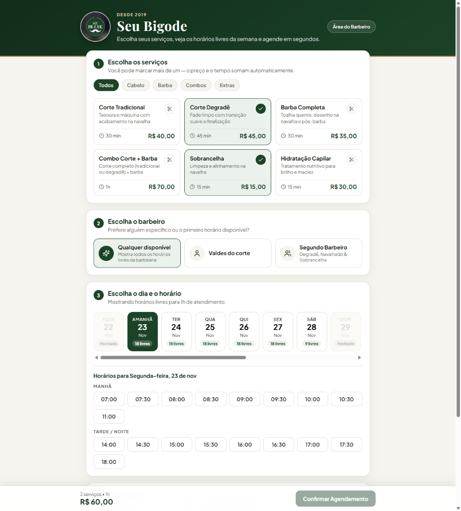
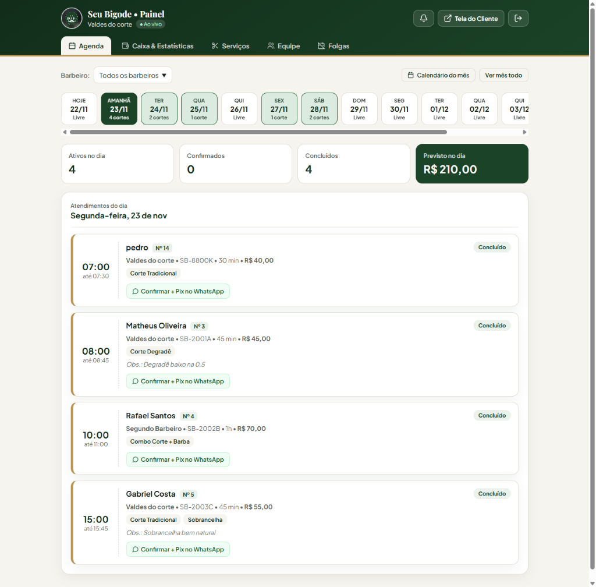
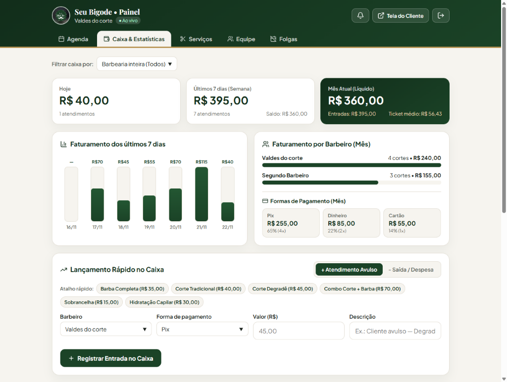

# 💈 Barbearia Seu Bigode — Sistema de Agendamento & Gestão

Aplicação web full-stack desenvolvida para a **Barbearia Seu Bigode (Desde 2019)**, reunindo agendamento online sem login para o cliente, painel administrativo multi-barbeiro com notificações em tempo real (SSE) e controle completo de caixa e estatísticas.

---

## Capturas de Tela

### 1. Agendamento Online do Cliente (`/`)
Escolha de múltiplos serviços com cálculo automático de preço e duração, seleção de barbeiro (ou *"Qualquer disponível"*), calendário de dias futuros com horários livres em tempo real e comprovante digital com **Pix Copia e Cola** + envio pelo WhatsApp.



### 2. Painel do Barbeiro — Agenda (`/admin`)
Faixa compacta de dias (pensada para uso no celular) + calendário mensal expansível, filtro por barbeiro, notificações instantâneas de novos agendamentos via **SSE**, confirmação em 1 clique pelo WhatsApp com chave Pix e fechamento direto para o caixa.



### 3. Controle de Caixa & Estatísticas
Acompanhamento de faturamento (**Hoje**, **Semana** e **Mês**), ticket médio, gráfico dos últimos 7 dias, comparativo por barbeiro, formas de pagamento (Pix, Dinheiro e Cartão), registro de atendimentos avulsos e despesas.



---

## Funcionalidades

### Lado do Cliente (Link na Bio)
- **Sem cadastro nem senha:** agenda em segundos informando apenas Nome e WhatsApp.
- **Combos inteligentes:** soma automaticamente preço e duração total, bloqueando horários que invadiriam almoço, folgas ou o próximo atendimento.
- **Trava contra agendamento duplo:** validação dentro de transação SQL (`BEGIN IMMEDIATE`) no SQLite.
- **Comprovante digital:** exibe número sequencial (`ATENDIMENTO Nº X`), código único, **Chave Pix Copia e Cola** opcional e botão de envio formatado no WhatsApp.

### Lado do Barbeiro (`/admin`)
- **Autenticação segura:** senhas com hash `scrypt` + `salt` e sessão via **JWT (HS256)** implementados nativamente com `node:crypto`.
- **Notificações ao vivo (SSE):** alertas persistentes com aviso sonoro opcional assim que um cliente fecha um horário.
- **Multi-barbeiro escalável:** cadastre, edite ou desative barbeiros, gerencie o catálogo de serviços e lance bloqueios/folgas.
- **Caixa integrado:** concluir um atendimento já registra a entrada automaticamente (com forma de pagamento), além de suportar atendimentos avulsos e despesas.
- **Configuração direta no painel:** edite a Chave Pix, titular e WhatsApp da barbearia sem mexer em código.

---

## Tecnologias

- **Frontend:** React 19, Vite 6, Lucide Icons, CSS modular (mobile-first)
- **Backend:** Node.js (ESM), Express 5, Server-Sent Events (SSE)
- **Banco de Dados:** SQLite nativo (`node:sqlite` com WAL e Prepared Statements)
- **Testes:** `node --test` (14 testes automatizados cobrindo motor de horários, API pública, autenticação, gestão e caixa)

---

## Estrutura do Projeto

```text
seu-bigode/
├── backend/
│   ├── src/
│   │   ├── db/            # Schema SQL, conexão SQLite e seeds
│   │   ├── middlewares/   # Proteção JWT
│   │   ├── routes/        # Rotas públicas, auth, admin e caixa
│   │   ├── services/      # Motor de horários livres, auth e SSE
│   │   └── server.js
│   └── tests/             # Testes unitários e de integração (node --test)
├── frontend/
│   ├── public/            # Logo da marca Seu Bigode
│   └── src/
│       ├── components/    # Calendário, horários, comprovante, toast SSE e caixa
│       ├── pages/         # AgendarPage, LoginPage e AdminPage
│       ├── services/      # Clientes de API pública e admin
│       └── utils/         # Formatação e mensagens de WhatsApp
└── docs/screenshots/      # Capturas de tela do sistema
```

---

## Como Rodar Localmente

1. Instale as dependências:
   ```bash
   npm --prefix backend install
   npm --prefix frontend install
   ```
2. *(Opcional)* Popule dados de demonstração (agendamentos e movimentações de exemplo):
   ```bash
   node backend/src/db/seed-demo.js
   ```
3. Inicie o backend e o frontend em dois terminais:
   ```bash
   npm run dev:backend
   npm run dev:frontend
   ```
4. Acesse no navegador:
   - **Tela do Cliente:** `http://localhost:5173`
   - **Painel do Barbeiro:** `http://localhost:5173/admin`
     - Acesso inicial de teste: `dono@seubigode.com` / senha `123456`

### Rodar Testes Automatizados
```bash
npm test
```

---

## Roadmap

- [x] **Fase 1:** Base do projeto, banco SQLite, motor de horários livres, calendário de dias futuros e tela pública de agendamento
- [x] **Fase 2:** Painel do barbeiro (`/admin`), login JWT, notificações ao vivo (SSE), gestão de serviços, equipe e folgas
- [x] **Fase 3:** Controle de caixa, fechamento automático de atendimento, atendimento avulso, despesas, estatísticas e Pix Copia e Cola + WhatsApp
- [ ] **Fase 4:** Refinamento visual (menos texto e UI mais enxuta), suporte a PostgreSQL na nuvem (Neon.tech), PWA instalável no celular e deploy no Render
